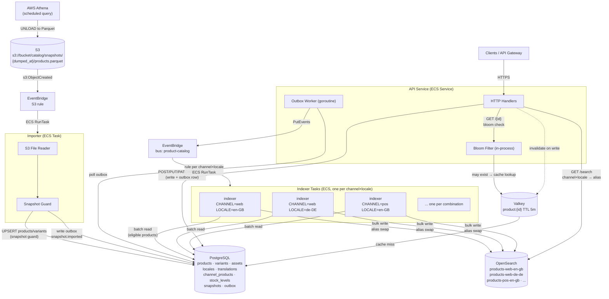
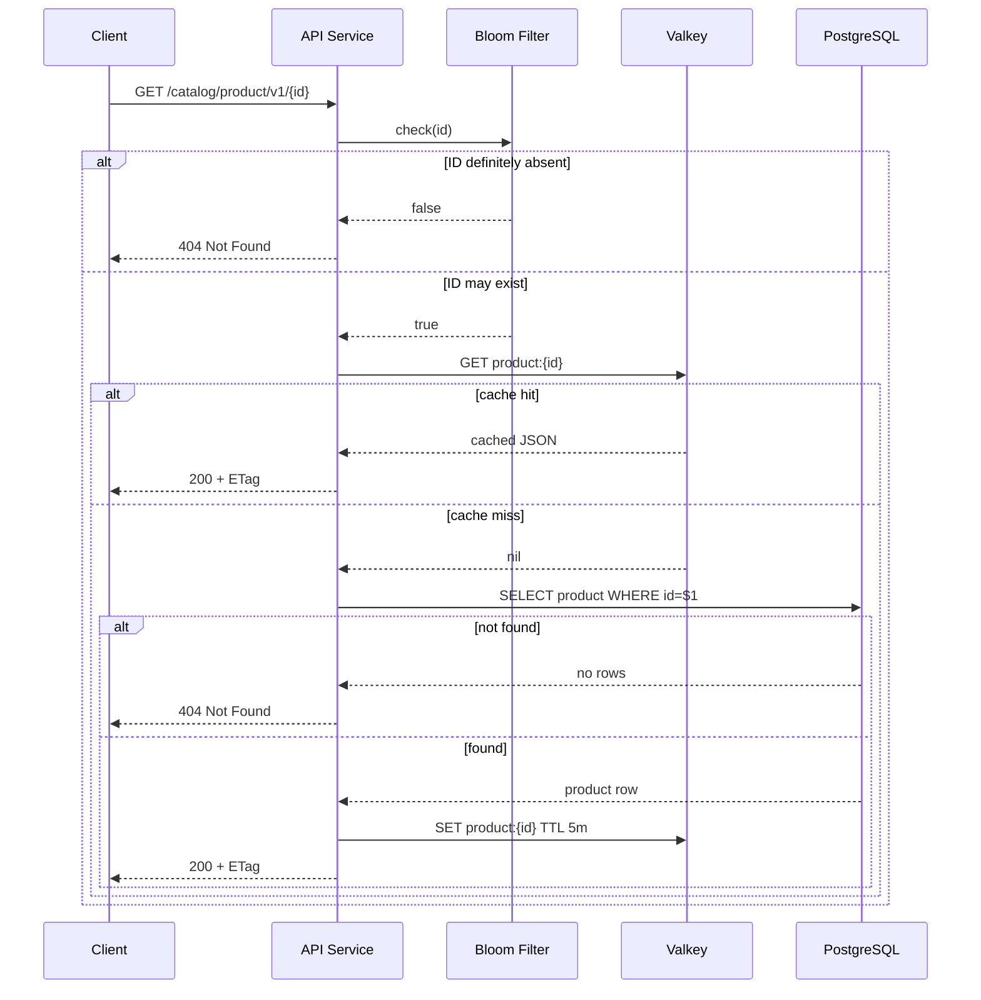
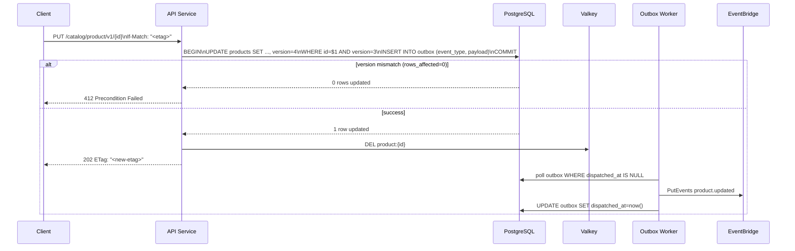
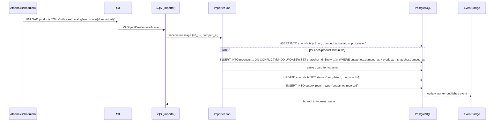
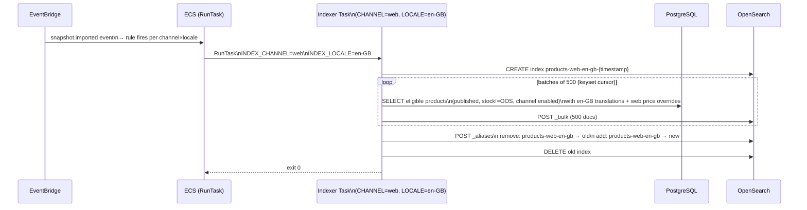
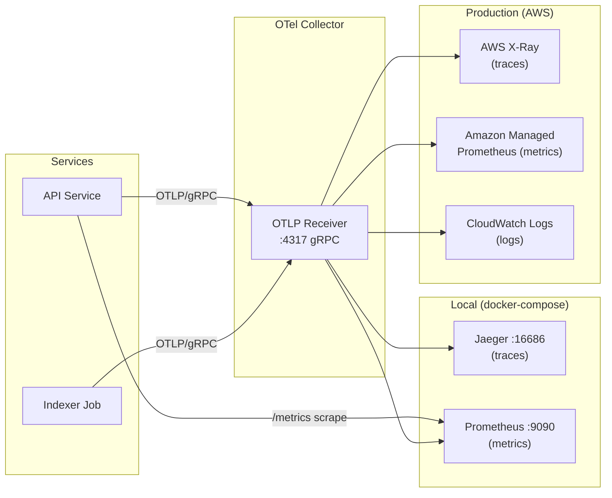

# Infrastructure Diagram

> All diagrams are Mermaid. See `.kiro/steering/diagramming.md` for the diagramming standard.

## System Overview

## Single-Product GET Flow

## Mutation Flow (Optimistic Locking + Outbox)

## Import Pipeline — Athena Snapshot Ingestion

> The snapshot guard (`WHERE snapshots.dumped_at > products→snapshot.dumped_at`) is evaluated in a single `UPDATE ... FROM snapshots` join, making it atomic per row. A re-run of the same dump is a no-op because `dumped_at` is equal, not greater.

## Indexer — Sequential Blue/Green Re-index per Channel×Locale

> Each channel×locale task runs concurrently — they write to different indexes so there is no contention. A single sequential worker handles hundreds of thousands of products in 1–2 minutes; parallelising within one index would cause OpenSearch merge pressure and be slower overall. See ADR-010.

## Observability Pipeline

## Local Development Services (docker-compose)

| Service | Port | Purpose |
|---|---|---|
| `postgres` | 5432 | Primary data store |
| `valkey` | 6379 | Cache + idempotency keys |
| `opensearch` | 9200 | Search index |
| `localstack` | 4566 | SQS + EventBridge (local AWS) |
| `otel-collector` | 4317 | OTLP gRPC receiver |
| `jaeger` | 16686 | Trace UI |
| `prometheus` | 9090 | Metrics UI |
| `api` | 8080 | API service |
| `indexer` | — | Runs once on start for local dev (CHANNEL+LOCALE from env); in prod triggered by EventBridge |

## Key Design Decisions

| ADR | Decision |
|---|---|
| ADR-001 | Go as the implementation language |
| ADR-002 | OpenSearch for search and list |
| ADR-003 | PostgreSQL over a document database |
| ADR-004 | Valkey cache + Bloom filter for GET by ID |
| ADR-005 | Outbox pattern + EventBridge fan-out |
| ADR-006 | Idempotency keys + optimistic locking (If-Match / ETag) |
| ADR-007 | Kubernetes / ECS deployment |
| ADR-008 | OpenTelemetry for tracing, metrics, and logging |
| ADR-010 | Indexer design — sequential worker, per-channel-locale indexes, ECS Task trigger |
