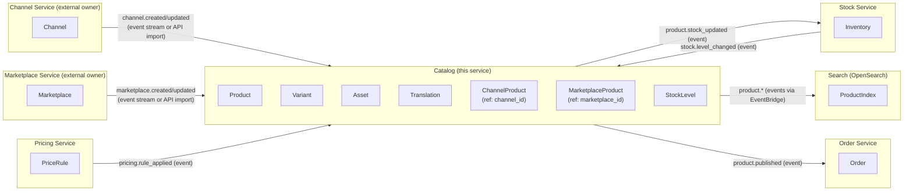
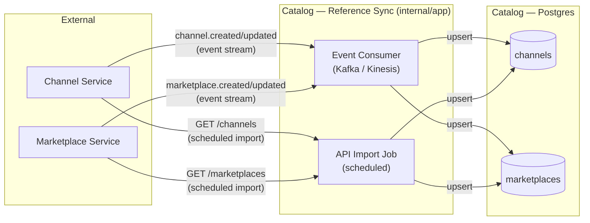
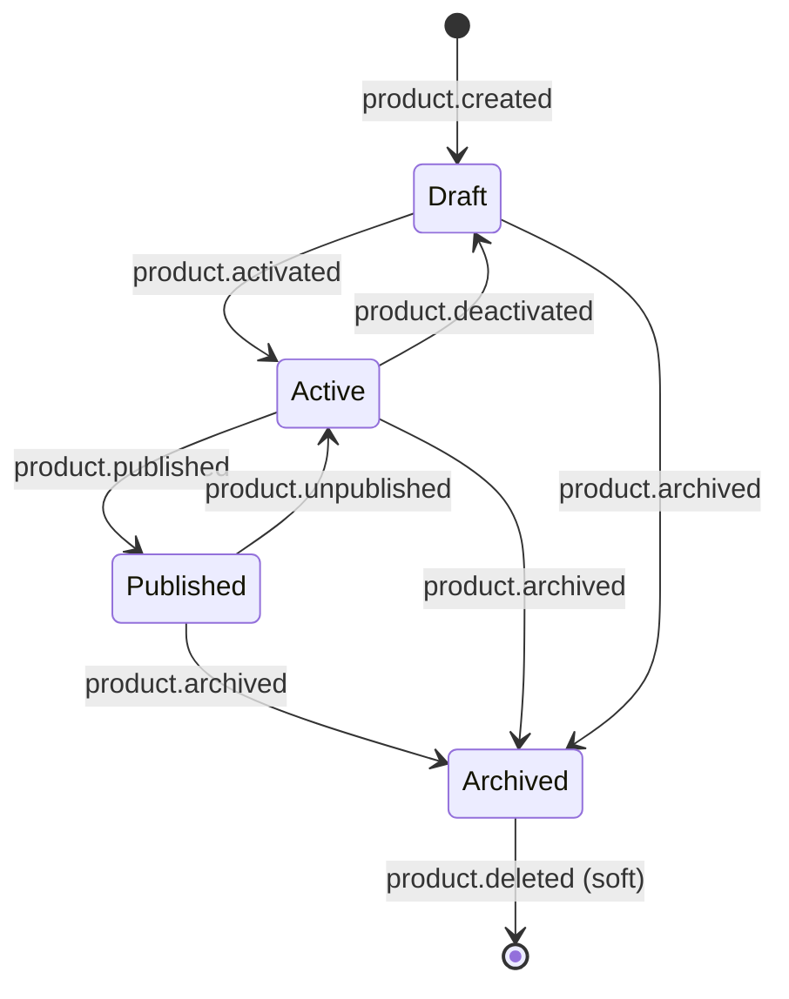

# ADR-009: Domain Model — Product Catalog Bounded Context

## Status
Accepted

## Domain
**Product**

## Bounded Context
**Catalog**

The Catalog context owns the authoritative representation of a product: what it is, how it is described, what variants it has, what it costs per channel, and whether it is available. It does **not** own order management, fulfilment, or customer data.

---

## Bounded Context Map



## Foreign References — Channel and Marketplace

`Channel` and `Marketplace` are **not aggregates owned by the Catalog**. They are defined and maintained by external domain services. The Catalog holds only a local reference table (`channels`, `marketplaces`) that is a read-only projection of the authoritative data from those services.

### Why a local reference table?
The Catalog needs channel and marketplace IDs at query time (filtering, index eligibility, views) without making a synchronous cross-service call on every read. Storing a lightweight local copy avoids that coupling.

### How the reference data is kept in sync — two options:

| Strategy | When to use | How |
|---|---|---|
| **Event stream** (preferred) | Channel/Marketplace service publishes to Kafka or Kinesis | Catalog consumes the stream, upserts into `channels` / `marketplaces` tables |
| **API import** (fallback) | No event stream available | A scheduled job calls the Channel/Marketplace service REST API and upserts the result |

Both strategies write to the same local tables; the rest of the Catalog is unaware of which sync mechanism is active.



### Rules
- The Catalog **never writes back** to the Channel or Marketplace service.
- `channel_products.channel_id` and `marketplace_products.marketplace_id` are foreign keys to the local reference tables — not to external services.
- If a channel or marketplace is deleted upstream, the local row is soft-deleted (`active = false`); existing `channel_products` rows are not cascaded — they become ineligible for indexing until the product is explicitly updated.
- The local reference tables carry only the fields the Catalog needs: `id`, `code`, `name`, `active`. All other channel/marketplace attributes remain in the owning service.

---

## Capabilities

The Catalog context exposes the following capabilities via its REST API and domain events:

| Capability | Description |
|---|---|
| **Create Product** | Register a new master product with at least one variant |
| **Update Product** | Mutate product attributes, translations, channel visibility, or pricing (idempotent, optimistic lock) |
| **Delete Product** | Soft-delete a product; removes it from the search index and marks it unavailable |
| **Get Product** | Retrieve a single product by ID (Bloom filter → Valkey → Postgres) |
| **Search / List Products** | Filter by category, price range, locale, channel, full-text; cursor-paginated (OpenSearch) |
| **Manage Variants** | Add, update, or remove variants (size, colour, etc.) on a product |
| **Manage Assets** | Attach or remove images and media to a product or variant |
| **Manage Translations** | Set localised name, description, and slug per locale |
| **Manage Channel Visibility** | Enable/disable a product per sales channel; set channel-specific price overrides |
| **Manage Marketplace Listings** | Set marketplace-specific metadata (external IDs, feed attributes) |
| **Receive Stock Updates** | Consume `stock.level_changed` events and update variant stock levels |
| **Index Management** | Full blue/green re-index and incremental index updates driven by domain events |

---

## Aggregate Design

See [`docs/domain/product-aggregate.md`](../domain/product-aggregate.md) for the full aggregate definition, invariants, option/variant model, and a worked example.

### Key points
- `Product` is the aggregate root — all mutations go through it
- **SKU lives on `Variant`, not on `Product`**
- Variants are determined by `Option` / `OptionValue` combinations (e.g. Size × Colour)
- A product with no options has exactly one implicit variant
- `VariantOptionValue` is the join that records which option values a variant represents

```mermaid
erDiagram
    PRODUCT {
        uuid id PK
        string status
        int version
        timestamptz created_at
        timestamptz updated_at
        timestamptz deleted_at
    }
    OPTION {
        uuid id PK
        uuid product_id FK
        string code
        int sort_order
    }
    OPTION_TRANSLATION {
        uuid option_id FK
        string locale_code FK
        string name
    }
    OPTION_VALUE {
        uuid id PK
        uuid option_id FK
        string code
        int sort_order
    }
    OPTION_VALUE_TRANSLATION {
        uuid option_value_id FK
        string locale_code FK
        string value
    }
    VARIANT {
        uuid id PK
        uuid product_id FK
        string sku
        numeric price
        string currency
        int version
    }
    VARIANT_OPTION_VALUE {
        uuid variant_id FK
        uuid option_value_id FK
    }
    ASSET {
        uuid id PK
        uuid product_id FK
        uuid variant_id FK
        string url
        string type
        int sort_order
    }
    PRODUCT_TRANSLATION {
        uuid product_id FK
        string locale_code FK
        string title
        string slug
        string description
        string short_description
        string meta_title
        string meta_description
    }
    VARIANT_TRANSLATION {
        uuid variant_id FK
        string locale_code FK
        string title
        string description
    }
    CHANNEL_PRODUCT {
        uuid channel_id FK
        uuid product_id FK
        bool enabled
        numeric price_override
        string currency
        int version
    }
    MARKETPLACE_PRODUCT {
        uuid marketplace_id FK
        uuid product_id FK
        string external_id
        jsonb feed_attributes
        int version
    }
    STOCK_LEVEL {
        uuid variant_id FK
        string warehouse_code
        string level
        int version
    }

    PRODUCT ||--o{ OPTION : "defines"
    OPTION ||--o{ OPTION_TRANSLATION : "translated by"
    OPTION ||--o{ OPTION_VALUE : "has"
    OPTION_VALUE ||--o{ OPTION_VALUE_TRANSLATION : "translated by"
    PRODUCT ||--o{ VARIANT : "has"
    VARIANT ||--o{ VARIANT_OPTION_VALUE : "selected by"
    VARIANT_OPTION_VALUE }o--|| OPTION_VALUE : "references"
    PRODUCT ||--o{ ASSET : "has"
    VARIANT ||--o{ ASSET : "has"
    PRODUCT ||--o{ PRODUCT_TRANSLATION : "translated by"
    VARIANT ||--o{ VARIANT_TRANSLATION : "translated by"
    PRODUCT ||--o{ CHANNEL_PRODUCT : "listed in"
    PRODUCT ||--o{ MARKETPLACE_PRODUCT : "listed on"
    VARIANT ||--o{ STOCK_LEVEL : "stocked at"
```



---

## Product Status State Machine



**Index eligibility**: only `Published` products with at least one variant where `stock_level.level != 'OOS'` and `channel_product.enabled = true` are indexed in OpenSearch.

---

## Domain Events

All events are published via the Transactional Outbox → EventBridge (see ADR-005). The `source` field is always `product-catalog`.

### Product Events

| Event Type | Trigger | Key Payload Fields |
|---|---|---|
| `product.created` | New product persisted | `product_id`, `sku`, `version` |
| `product.updated` | Any product attribute mutated | `product_id`, `version`, `changed_fields[]` |
| `product.activated` | Status transitions to `active` | `product_id`, `version` |
| `product.deactivated` | Status transitions back to `draft` | `product_id`, `version` |
| `product.published` | Status transitions to `published` | `product_id`, `version`, `channel_ids[]` |
| `product.unpublished` | Status transitions from `published` to `active` | `product_id`, `version` |
| `product.archived` | Product archived | `product_id`, `version` |
| `product.deleted` | Soft delete applied | `product_id`, `version` |

### Variant Events

| Event Type | Trigger | Key Payload Fields |
|---|---|---|
| `variant.created` | New variant added to product | `product_id`, `variant_id`, `sku`, `version` |
| `variant.updated` | Variant attributes mutated | `product_id`, `variant_id`, `version`, `changed_fields[]` |
| `variant.deleted` | Variant removed | `product_id`, `variant_id`, `version` |

### Stock Events

| Event Type | Trigger | Key Payload Fields |
|---|---|---|
| `product.stock_updated` | Stock status changed on a variant | `product_id`, `variant_id`, `warehouse_code`, `level`, `version` |
| `product.stock_depleted` | Variant status transitions to `OOS` | `product_id`, `variant_id`, `warehouse_code` |
| `product.stock_restored` | Variant status transitions from `OOS` to `LOW` or `IN_STOCK` | `product_id`, `variant_id`, `warehouse_code`, `level` |

### Channel / Marketplace Events

| Event Type | Trigger | Key Payload Fields |
|---|---|---|
| `product.channel_enabled` | Product enabled in a channel | `product_id`, `channel_id`, `version` |
| `product.channel_disabled` | Product disabled in a channel | `product_id`, `channel_id`, `version` |
| `product.marketplace_listed` | Product listed on a marketplace | `product_id`, `marketplace_id`, `external_id`, `version` |
| `product.marketplace_delisted` | Product removed from a marketplace | `product_id`, `marketplace_id`, `version` |

### Index Events (internal, not published externally)

| Event Type | Trigger | Key Payload Fields |
|---|---|---|
| `index.product_upserted` | Document written to OpenSearch | `product_id`, `index_name` |
| `index.product_removed` | Document removed from OpenSearch | `product_id`, `index_name` |
| `index.full_reindex_completed` | Blue/green swap finished | `index_name`, `doc_count`, `duration_ms` |

---

## Event Envelope

All events share this envelope (EventBridge `detail` field):

```json
{
  "event_id": "<uuid>",
  "event_type": "product.published",
  "source": "product-catalog",
  "occurred_at": "2024-01-15T10:30:00Z",
  "trace_id": "<otel-trace-id>",
  "span_id": "<otel-span-id>",
  "payload": { }
}
```

`trace_id` and `span_id` are injected from the active OTel span (see ADR-008) to enable end-to-end trace linking across async boundaries.

---

## Consequences
- The Catalog context is the system of record for product data; all other contexts consume events and must not write back to Catalog tables directly
- Stock levels are owned by the Catalog for read purposes (denormalised from the Stock service via events) — the Stock service remains authoritative
- Adding a new event type requires: a new outbox `event_type` constant in `domain/events.go`, a new EventBridge rule, and an update to this ADR
