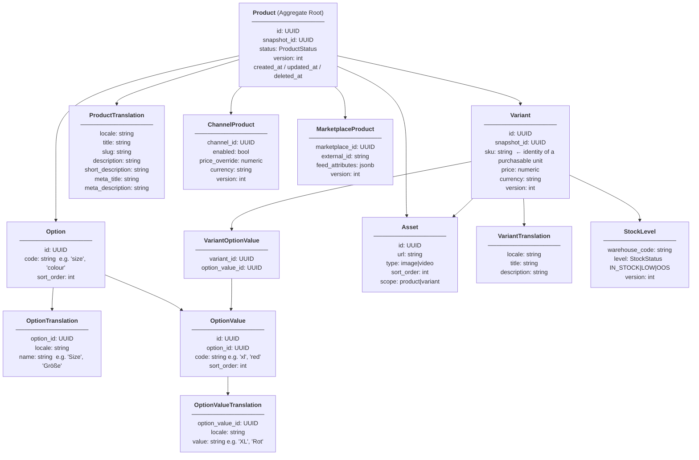
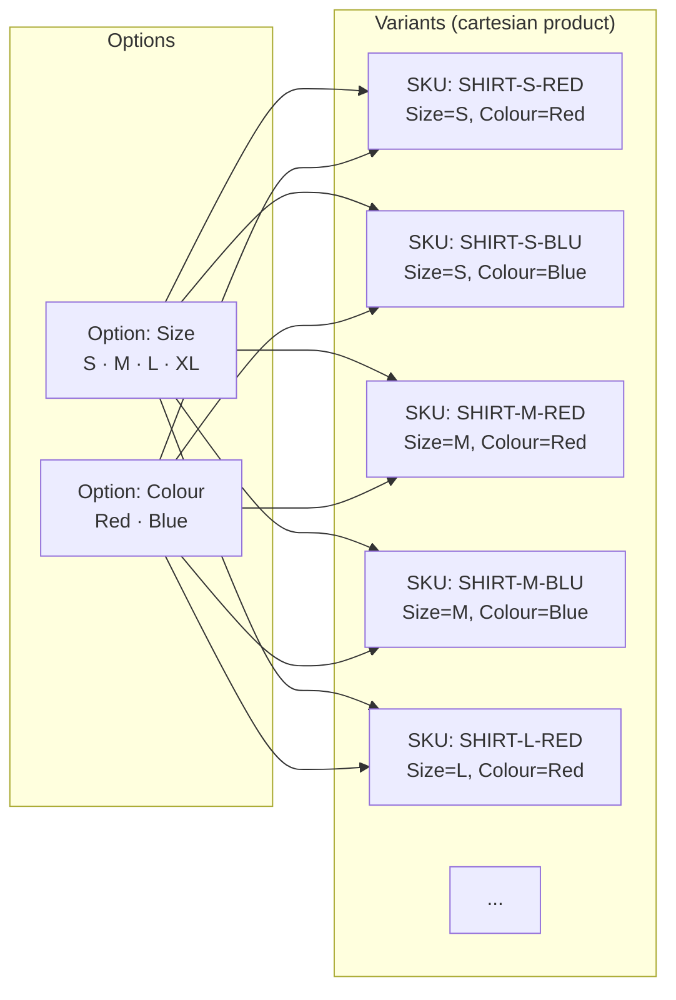
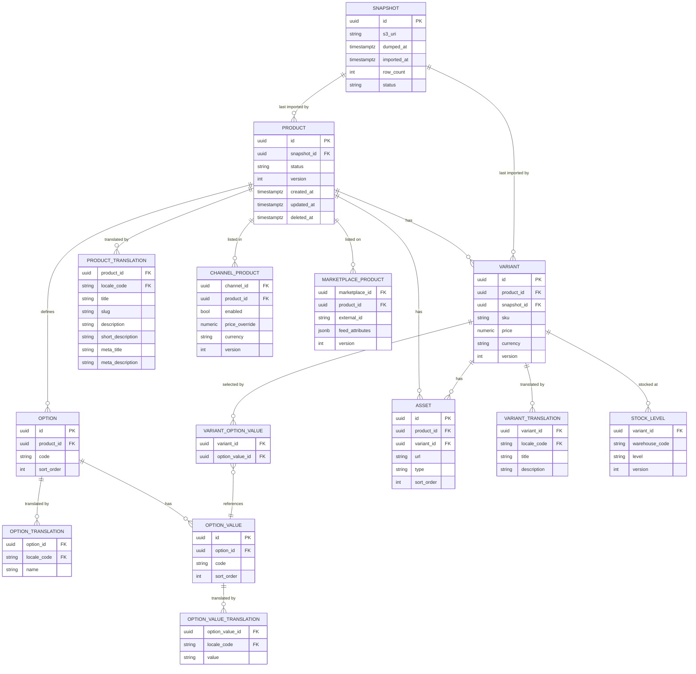

# Product Aggregate

## Overview

`Product` is the aggregate root of the Catalog bounded context. It groups everything needed to represent a sellable item: its options, the variants those options produce, assets, translations, channel visibility, and stock levels.

The aggregate boundary is intentional: all mutations to variants, options, and channel listings go through the `Product` root. No child entity is mutated independently — the root enforces invariants and emits domain events.

---

## Aggregate Structure



---

## Options and Variants

Options define the axes of variation for a product. Each option has a set of values. A variant is the concrete, purchasable combination of one value from each option.



### Rules
- A product with **no options** has exactly **one implicit variant** (the product itself is the purchasable unit). The variant SKU is set explicitly.
- A product with options must have at least one variant. Not all combinations need to exist (e.g. XL is only available in Blue).
- The **SKU lives on the Variant**, never on the Product root. The Product has no SKU field.
- `Option.code` and `OptionValue.code` are locale-neutral machine identifiers (e.g. `size`, `xl`). Human-readable labels live exclusively in `OptionTranslation` and `OptionValueTranslation`.
- Deleting an option value that is still referenced by a variant is a domain invariant violation — the aggregate rejects it.

---

## Entity Responsibilities

| Entity | Owns | Does NOT own |
|---|---|---|
| `Product` | Status, aggregate version, channel/marketplace listings, `snapshot_id` | SKU, price, stock, any human-readable text |
| `Snapshot` | S3 URI, `dumped_at` timestamp, import status, row count | Product data — Snapshot is a write-guard, not a data owner |
| `Option` | Locale-neutral `code` (e.g. `size`) and sort order | Human-readable label — that lives in `OptionTranslation` |
| `OptionTranslation` | Localised option name per locale (e.g. "Size", "Größe") | — |
| `OptionValue` | Locale-neutral `code` (e.g. `xl`) and sort order | Human-readable label — that lives in `OptionValueTranslation` |
| `OptionValueTranslation` | Localised option value per locale (e.g. "XL", "Rot") | — |
| `Variant` | SKU, base price, currency, option value combination | Product-level metadata, human-readable text |
| `VariantOptionValue` | The join between a variant and its selected option values | — |
| `Asset` | URL, type, sort order; scoped to product or a specific variant | Storage / CDN |
| `ProductTranslation` | `title`, `slug`, `description`, `short_description`, `meta_title`, `meta_description` per locale | Variant-level copy |
| `VariantTranslation` | Localised `title` and `description` per locale | Option labels |
| `ChannelProduct` | Per-channel enabled flag and price override | Channel config — Channel is owned by the Channel Service |
| `MarketplaceProduct` | External ID and feed attributes per marketplace | Marketplace config — Marketplace is owned by the Marketplace Service |
| `StockLevel` | Stock status per variant per warehouse (`IN_STOCK`, `LOW`, `OOS`) | Exact quantity — that is owned by the Stock Service |

> `ChannelProduct.channel_id` and `MarketplaceProduct.marketplace_id` are references to **locally cached** reference data synced from external services. See ADR-009 § Foreign References for the sync strategy.

---

## Invariants

The aggregate root enforces these invariants on every mutation:

1. A `Published` product must have at least one enabled `ChannelProduct`.
2. Every `Variant` must reference exactly one `OptionValue` per `Option` defined on the product (or zero options → one implicit variant).
3. An `OptionValue` cannot be removed if any `Variant` still references it.
4. A `Variant` SKU must be unique within the aggregate (enforced at DB level with a unique index too).
5. `StockLevel.level` must be one of the valid `StockStatus` values: `IN_STOCK`, `LOW`, `OOS`.
6. All mutations increment `version` on the affected entity and on the `Product` root.

---

## Data Model (ER)



> `StockStatus` is a domain enum: `IN_STOCK` | `LOW` | `OOS` (out of stock). The Catalog never stores exact quantities — those are owned by the Stock Service. The Catalog receives a translated status via `stock.level_changed` events.

### Localisation coverage

| Entity | Localised fields |
|---|---|
| `ProductTranslation` | `title`, `slug`, `description`, `short_description`, `meta_title`, `meta_description` |
| `VariantTranslation` | `title`, `description` |
| `OptionTranslation` | `name` (e.g. "Size" → "Größe") |
| `OptionValueTranslation` | `value` (e.g. "Red" → "Rot") |

No human-readable text lives on `Product`, `Option`, `OptionValue`, or `Variant` directly. All display copy is locale-scoped.

---

## Example: T-Shirt Product

```
Product: "Classic T-Shirt"  (id: prod-001, status: published)
│
├── Option: "Size"  (sort: 0)
│   ├── OptionValue: "S"
│   ├── OptionValue: "M"
│   ├── OptionValue: "L"
│   └── OptionValue: "XL"
│
├── Option: "Colour"  (sort: 1)
│   ├── OptionValue: "Red"
│   └── OptionValue: "Blue"
│
├── Variant: SKU=TSHIRT-S-RED   → Size=S,  Colour=Red   price=19.99 GBP
├── Variant: SKU=TSHIRT-S-BLU   → Size=S,  Colour=Blue  price=19.99 GBP
├── Variant: SKU=TSHIRT-M-RED   → Size=M,  Colour=Red   price=19.99 GBP
├── Variant: SKU=TSHIRT-M-BLU   → Size=M,  Colour=Blue  price=19.99 GBP
├── Variant: SKU=TSHIRT-L-RED   → Size=L,  Colour=Red   price=19.99 GBP
├── Variant: SKU=TSHIRT-L-BLU   → Size=L,  Colour=Blue  price=19.99 GBP
├── Variant: SKU=TSHIRT-XL-BLU  → Size=XL, Colour=Blue  price=21.99 GBP  ← XL only in Blue
│
├── ProductTranslation: en-GB → title="Classic T-Shirt"
│                               slug="classic-t-shirt"
│                               description="A timeless wardrobe staple."
│                               short_description="Everyday comfort."
│                               meta_title="Classic T-Shirt | MyStore"
│                               meta_description="Shop the Classic T-Shirt..."
├── ProductTranslation: de-DE → title="Klassisches T-Shirt"
│                               slug="klassisches-t-shirt"
│                               description="Ein zeitloser Klassiker."
│
├── OptionTranslation (size):   en-GB="Size"    de-DE="Größe"
├── OptionValueTranslation (xl): en-GB="XL"     de-DE="XL"
├── OptionValueTranslation (red): en-GB="Red"   de-DE="Rot"
│
├── VariantTranslation TSHIRT-S-RED: en-GB → title="Classic T-Shirt — S / Red"
│
├── ChannelProduct: web  → enabled=true,  price_override=null
├── ChannelProduct: pos  → enabled=true,  price_override=17.99
│
└── Asset: url=cdn/tshirt-hero.jpg  scope=product
    Asset: url=cdn/tshirt-red-s.jpg scope=variant TSHIRT-S-RED
```
